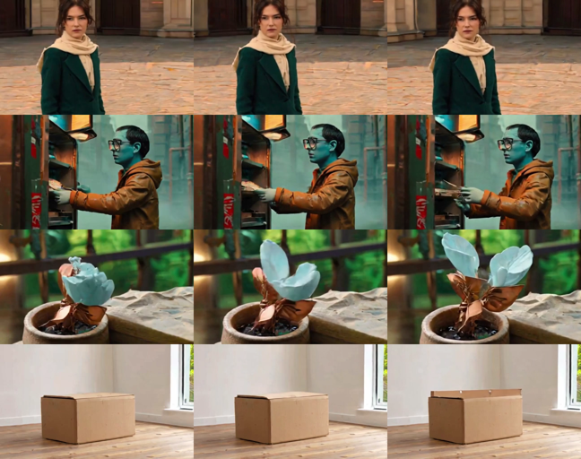
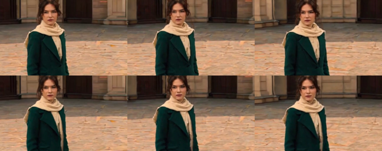

# Kandinsky 6.0 Lite-distill 5s — MLX

Weights of [**kandinskylab/Kandinsky-6.0-Lite-distill-5s-Diffusers**](https://huggingface.co/kandinskylab/Kandinsky-6.0-Lite-distill-5s-Diffusers)
(revision `4c487e8b`) converted for [MLX](https://github.com/ml-explore/mlx), with a native MLX pipeline that generates
**video with synchronized audio on Apple Silicon Macs**: [github.com/vladislav-vasilenko/kandinsky6-mlx](https://github.com/vladislav-vasilenko/kandinsky6-mlx).

This is an independent community port, not an official release of the Kandinsky team. All credit for the model goes to
[Kandinsky Lab](https://kandinskylab.ai/models/video/) — see the [technical report](https://arxiv.org/abs/2610.05608).

> **Status: early release.** Text-to-video+audio at the **Smoke** size (256×432, 25 frames, ~1 s) works end to end and
> is verified against diffusers. Not yet available: the 5 s **Baseline** size (needs tiled VAE decoding), image-to-video,
> and a one-command prompt-to-video (the CLIP text encoder still runs in PyTorch). See the roadmap below.

## Examples

Generated on an Apple M3 Max (48 GB) with this repository's weights: Smoke size, 10 PiFlow steps, seed 42, bf16 DiT.
Frames 0, 12 and 24 of each clip:



| Clip (with sound) | Prompt |
|---|---|
| <video controls width="360" src="https://huggingface.co/VVladTech/Kandinsky-6.0-Lite-distill-5s-MLX/resolve/main/examples/orbit_woman_smoke_seed42.mp4"></video> | Cinematic live-action fashion film, natural skin texture, restrained color grading, realistic cloth physics. An adult woman, about 28 years old, stands in a circular stone courtyard. She wears a deep emerald coat and a cream silk scarf. Archways and foreground columns establish clear depth. Warm late-afternoon side light; stable exposure and soft moving highlights. The camera makes a small, smooth 15-degree clockwise arc; keep her face centered. Do not attempt a full circle in one second. Initial state: The woman faces the camera, both feet planted; hair tied loosely; scarf rests on her right shoulder. One uninterrupted shot, about 1 seconds. From 0 to 0.35 seconds: Start from a frontal three-quarter view. The camera begins its arc, a near column slides slowly across the background. From 0.35 to 1 seconds: Continue the arc smoothly. She turns her eyes toward the lens and the scarf lifts slightly, then begins to settle. Same face and outfit throughout. \<AUDCAP\>Quiet courtyard air and a soft breeze. A brief silk rustle; no dialogue or music.\<ENDAUDCAP\> |
| <video controls width="360" src="https://huggingface.co/VVladTech/Kandinsky-6.0-Lite-distill-5s-MLX/resolve/main/examples/strange_tram_smoke_seed42.mp4"></video> | Surreal retrofuturist dark comedy, 1970s science-fiction cinema, tactile practical creature effects, worn brass, painted miniatures, muted teal and amber, subtle film grain. A rain-wet tram stop in an imaginary industrial city. An original pear-shaped, blue-skinned commuter with tiny spectacles and a tan raincoat waits beside a brass ticket machine. He has two arms and two legs. Overcast daylight mixed with warm tungsten light in the ticket machine. A short, slow push-in, without changing the view angle. Initial state: The commuter holds one paper ticket. The ticket slot is shut. Steam drifts behind the stop. One uninterrupted shot, about 1 seconds. From 0 to 0.4 seconds: The brass ticket slot clicks open. The commuter freezes and raises one eyebrow. From 0.4 to 1 seconds: A small mechanical tongue briefly taps the edge of his ticket, then retracts. The commuter blinks in deadpan disbelief. \<AUDCAP\>One dry metallic click over quiet rain. A soft rubbery squeak and a tiny bell; no speech.\<ENDAUDCAP\> |
| <video controls width="360" src="https://huggingface.co/VVladTech/Kandinsky-6.0-Lite-distill-5s-MLX/resolve/main/examples/mechanical_bloom_smoke_seed42.mp4"></video> | Tactile miniature science-fiction film, stop-motion-inspired creature design with smooth motion, copper mechanisms and translucent botanical tissue, detailed macro photography. An original small flower made of copper ribs and translucent pale-blue petals grows from a cracked ceramic pot on a workbench. The background is an unfocused greenhouse. Soft green backlight through glass with a warm practical lamp on the workbench. A tiny sideways camera slide creating gentle foreground parallax. Initial state: One closed flower bud; a drop of water hangs from a copper leaf. One uninterrupted shot, about 1 seconds. From 0 to 0.5 seconds: The bud quivers and the first pair of petals separates. From 0.5 to 1 seconds: The petals open a little farther and release one small puff of glowing pollen. The pot and bench stay fixed. \<AUDCAP\>A quiet metallic tick. A soft pneumatic puff and a delicate chime; no voice.\<ENDAUDCAP\> |
| <video controls width="360" src="https://huggingface.co/VVladTech/Kandinsky-6.0-Lite-distill-5s-MLX/resolve/main/examples/room_assembly_smoke_seed42.mp4"></video> | Photorealistic Scandinavian furniture commercial, clean geometric composition, natural materials, restrained palette. An empty sunlit room with white walls, a pale oak floor and one large window. The room is unoccupied. Soft stable morning light from the left window. Completely locked-off wide shot. Initial state: One unbranded flat-pack cardboard box in the center of the room. No other furniture. One uninterrupted shot, about 1 seconds. From 0 to 0.3 seconds: The sealed cardboard box begins to tremble gently. From 0.3 to 1 seconds: Its top flaps pop open and the first pair of wooden bed rails rises a short distance above the box. The rest stays packed. \<AUDCAP\>A low brief cardboard rattle. A soft pop and two wooden clacks. The room is otherwise quiet.\<ENDAUDCAP\> |

Prompts follow the structure recommended for Kandinsky 6: style, scene, lighting, camera, initial state, a timed
action list, and sound inside `<AUDCAP>…<ENDAUDCAP>`. The distilled model runs without classifier-free guidance, so
there are no negative prompts.

## Quick start (Apple Silicon)

Requirements: macOS on Apple Silicon, Python 3.11+, [uv](https://docs.astral.sh/uv/), **32 GB of unified memory or
more** for now (the Smoke video decode peaks at about 20 GB; a 16 GB profile is planned), and about 26 GB of disk for
the weights below.

```bash
git clone https://github.com/vladislav-vasilenko/kandinsky6-mlx && cd kandinsky6-mlx
uv sync --extra text --group reference      # MLX + mlx-vlm; PyTorch only for the CLIP pooled embedding

# This repository: DiT, video VAE, audio VAE, vocoder (8.5 GB)
uv run hf download VVladTech/Kandinsky-6.0-Lite-distill-5s-MLX --local-dir weights/lite-distill

# Text encoders from the original repository: Qwen2.5-VL-7B (15.5 GB) + CLIP-L and tokenizers
uv run hf download kandinskylab/Kandinsky-6.0-Lite-distill-5s-Diffusers --revision 4c487e8b4aeeb9059e5a77905aa2ddb59ec28f81 \
    --include "text_encoder/*" --include "tokenizer/*" --include "text_encoder_2/*" --include "tokenizer_2/*" \
    --local-dir weights/lite-distill-text
```

1. Encode the prompt (Qwen2.5-VL runs in MLX via [mlx-vlm](https://github.com/Blaizzy/mlx-vlm), about 1 s on an M3 Max):

```bash
uv run --extra text --group reference python scripts/encode_prompt.py \
    --qwen-weights weights/lite-distill-text/text_encoder/model-0000*-of-00005.safetensors \
    --text-root weights/lite-distill-text \
    --prompt "Cinematic live-action fashion film ... <AUDCAP>Quiet courtyard air and a soft breeze.<ENDAUDCAP>" \
    --out prompts/my_prompt
```

2. Generate an MP4 with sound (H.264 + AAC):

```bash
uv run python scripts/generate.py --weights weights/lite-distill \
    --text-embeds prompts/my_prompt.safetensors --preset smoke --seed 42 --out my_video.mp4
```

From Python:

```python
from kandinsky6_mlx.pipelines.t2v import Kandinsky6Pipeline, load_text_embeds
from kandinsky6_mlx.pipelines.export import write_mp4

pipe = Kandinsky6Pipeline.from_converted("weights/lite-distill")          # DiT in bf16 by default
out = pipe(load_text_embeds("prompts/my_prompt"), height=256, width=432, num_frames=25, seed=42)
write_mp4("my_video.mp4", out.frames[0], out.frame_rate, out.audio[0], out.sample_rate)
print(out.timings, out.peak_memory_gib)
```

The seed drives NumPy noise, so a given seed does not reproduce a diffusers or ComfyUI run with the same seed.

## Performance (Apple M3 Max, 40-core GPU, 48 GB)

| Smoke 256×432, 25 frames, 10 steps | Time | Peak memory |
|---|---|---|
| Prompt encoding (Qwen2.5-VL bf16, MLX) | ~1 s | 13.4 GB |
| Denoising (DiT bf16) | 13–16 s | 8.1 GB |
| Video VAE decode | 7.5 s (warm), 12–23 s (first run in a process) | 20.3 GB |
| Audio VAE + vocoder | 0.4 s | 4.6 GB |

For reference, the study runs of the diffusers pipeline on a Kaggle 2×T4 took about 13 s to denoise Smoke. The DiT
alone at Baseline size (480×864, 121 frames, 50 220 video tokens) takes 76 s per step on the M3 Max; Baseline decoding
needs the tiled VAE that is still in progress.

## Verification against diffusers

Every component is compared with the PyTorch reference (`diffusers==0.42.1`) on the real weights; full reports are in
the GitHub repository (`reports/*.json`).

| Component | Check | Result |
|---|---|---|
| DiT (bf16) | every block and the final outputs vs the float32 reference, relative to PyTorch bf16 drift | 0.56–1.12× the PyTorch bf16 error, cosine ≥ 0.99997 per block |
| Video VAE decoder (float32) | 25 decoded frames vs diffusers | PSNR 121.7 dB |
| Audio VAE + BigVGAN vocoder (float32) | waveform vs diffusers | SNR 92.9 dB |
| PiFlow scheduler | 10 steps | bit-identical |
| Whole pipeline, float32 DiT | 10 steps from the same noise vs the diffusers pipeline | latents rel_l2 ≤ 7.2e-5, frames 96.6 dB, audio 85.2 dB |
| Whole pipeline, bf16 DiT | same, vs the float32 reference | frames 27.4 dB, matching PyTorch bf16 (27.7 dB): ten distilled steps amplify bf16 rounding in both |

Side by side, MLX bf16 (top) and the diffusers float32 reference (bottom) from the same noise:



## Files

| File | Tensors | Dtypes | Size | SHA-256 |
|---|---|---|---|---|
| `transformer/model.safetensors` | 2399 | 1976 BF16, 423 F32 | 5.94 GiB | `62a3dba4a4187f56e525997f0270b282e3787f735879b0bc3cd316dbc4579fee` |
| `vae/model.safetensors` | 248 | F32 | 0.92 GiB | `c90f898a5284ed365630f02d099247b6c0ae79ab6c93d16c0fbcbb109c693d12` |
| `audio_vae/model.safetensors` | 59 | F32 | 1.14 GiB | `ad3869e1145db1e5ce2f657c909ede6586278655e00960f58f9507b0b2d890a3` |
| `vocoder/model.safetensors` | 667 | F32 | 0.46 GiB | `7d903ad9b4c3d80cef04b5fbcca30568e3c6485102b32493e4f9dec0ae09f388` |

What the conversion changes: convolution weights are moved to MLX's channels-last layouts, and the duplicate vocoder
stored inside the original `audio_vae` is dropped. Every tensor keeps its stored dtype (BF16 data byte-identical); as in
diffusers, the DiT's time embeddings and modulation are upcast to float32 when loading. Each folder keeps the original
`config.json` and a `conversion.json` with source file hashes. The text encoders are not included: `text_encoder/` of
the original repository is the unmodified Qwen2.5-VL-7B-Instruct and `text_encoder_2/` is CLIP-L.

## Roadmap

- Tiled video VAE decoding for the 5 s Baseline size, and a 16 GB-Mac memory profile.
- CLIP-L in MLX and a single prompt-to-video command.
- Image-to-video (reference-frame conditioning).
- Non-distilled checkpoints (FlowMatch + classifier-free guidance), the Pro model, speed work (`mx.compile`, fused
  kernels) and quantization.

## License

MIT, as the original model ([kandinskylab/Kandinsky-6.0-Lite-distill-5s-Diffusers](https://huggingface.co/kandinskylab/Kandinsky-6.0-Lite-distill-5s-Diffusers)).
The text encoders you download separately keep their own licenses (Qwen2.5-VL-7B-Instruct: Apache 2.0).

## Citation

Please cite the original work:

```bibtex
@misc{kandinsky2026kandinsky60videofoundation,
      title={Kandinsky 6.0 Video: Foundation Models for Synchronized Video and Audio Generation}, 
      author={Team Kandinsky and Julia Agafonova and Bulat Akhmatov and Mikhail Aksyutin and Grigorii Alekseenko and Anastasia Aliaskina and Olga Androsova and Vladimir Arkhipkin and Anna Averchenkova and Alexander Belykh and Serafima Bocharova and Sofiya Bogakovskaya and Anton Bukashkin and Mark Bulygin and Kirill Buzygin and Irina Cheremnykh and Kirill Chernyshev and Mikhail Chernyshov and Vladimir Chernyy and David Chikovani and Georgy Daniltsev and Denis Dimitrov and Anna Dmitrienko and Vladimir Dokholyan and Sergey Emelyanov and Dmitry Ermilov and Georgii Fedorov and Polina Gavrilova and Nikolai Gerasimenko and Aleksandr Gordeev and Andrey Inozemtsev and Andrei Ivaniuta and Alexander Ivanov and Mikhail Karaev and Anastasiia Kargapoltseva and Ivan Kirillov and Nikita Kiselev and Valeria Kobenko and Yury Kolabushin and Denis Koposov and Anatoly Korobov and Vladimir Korviakov and Kirill Kozlov and Denis Krzhivokolskiy and Konstantin Kuklev and Alexander Kunitsyn and Sergey Kuzin and Vladislav Lakhtionov and Alexey Letunovskiy and Maxim Litvinov and Alexander Lyulkov and Georgy Makarov and Kirill Malakhov and Egor Malykh and Mikhail Mamaev and Dmitrii Mikhailov and Polina Mikhailova and Ivan Mikheev and Elizaveta Muromtseva and Nikolai Nazarkin and Tatiana Nikulina and Lev Novitskiy and Stanislav Onuchin and Nikita Osterov and Denis Parkhomenko and Anatoliy Parpara and Vladimir Polovnikov and Konstantin Reznikov and Azat Saginbaev and Nikita Samsonov and Alexander Sentsov and Nikita Shaimov and Artem Sherstyuk and Andrey Shutkin and Egor Silvestrov and Bulat Suleimanov and Matvey Suprunov and Sergey Taranov and Irina Tolstykh and Tatiana Trofimuk and Ilya Trushkin and Aleksandra Tsybina and Olga Varlashina and Viacheslav Vasilev and Ilya Vasiliev and Eugeny Vilisov and Sergey Yakubson and Konstantin Zakharov},
      year={2026},
      eprint={2610.05608},
      archivePrefix={arXiv},
      primaryClass={cs.CV},
      url={https://arxiv.org/abs/2610.05608}, 
}
```
